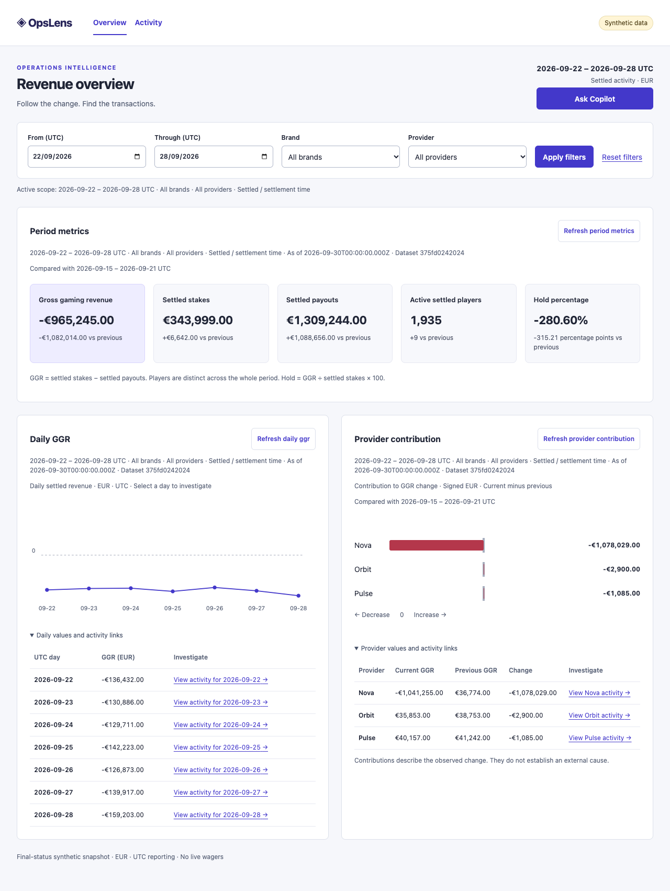

# OpsLens case study

An operations analyst sees weekly gross gaming revenue (GGR) fall. To understand the change, they need to preserve the reporting period and filters while moving from the aggregate to the individual transactions. OpsLens turns those transitions into one investigation, using a synthetic iGaming dataset with a seeded payout spike.

## From a revenue change to transaction evidence

On the 100,000-row snapshot, GGR moved from €116,769 to −€965,245 between the weeks of 15–21 and 22–28 September 2026 UTC. Nova contributed −€1,078,029 of the −€1,082,014 change. Overview compares equal weeks on settlement time. Selecting Nova opens Activity with the exact UTC boundaries, settled status, provider and dataset hash. Transaction details expose the underlying timestamps, stake and payout. [Metric contract](../metric-contract.md) · [Independent results](../../superset/reconciliation.json)

The labelled recorded Copilot example gives the same figures in its original synthetic scope. Its link reopens the matching Nova transactions. The payout spike is an observed contribution in the synthetic data. The snapshot contains no evidence of an operational incident. [Three-minute walkthrough and transcript](walkthrough.md)

[Scoped Activity screenshot](nova-activity.png) · [Recorded Copilot screenshot](recorded-copilot.png) · [390 px Overview screenshot](overview-mobile.png)

## Decisions and tradeoffs

| Decision | What it buys and what it costs |
| --- | --- |
| Put reporting scope in the URL and attach a dataset hash to drill-downs | An investigation survives reload and browser history. The app must reject stale results and surface snapshot mismatches before users inspect rows. [Analytics API](../analytics-api.md) |
| Keep metric arithmetic, filtering and paging in PostgreSQL | The browser handles a small page while summary metrics cover the whole slice. Deep offset sorts still cost database work. The default semantic table gives access to a full page, and virtual scrolling is opt-in. [Activity setup](../runtime.md#activity--plan-07) |
| Use native SVG and CSS for bounded series, with named links and table alternatives | The chart marks participate in the same navigation as the underlying data. This keeps dependencies small and leaves the chart interactions and responsive behavior in the app. [Screen notes](../screen-notes.md) |
| Share five typed components and scoped tokens | Overview and Activity use the same filters, panels, badges and feedback patterns. The Support inbox story exercises the components in another composition. Data fetching and metric formatting stay with the consumer. [UI package](../../packages/ui/README.md) |
| Separate numerical analytics from documentation retrieval | Validated, read-only tools produce numerical evidence. Managed File Search is implemented for curated definitions and runbooks, with versioned source resolution and simulated tests. The portfolio runs the recorded example. Live document evidence stays disabled pending hosted and human relevance checks. [Copilot design](../ai-copilot.md) |

## Superset baseline and React result

[Superset baseline screenshot](../../superset/dashboard.png) · [React Overview screenshot](overview.png)

Both views cover the same fixed default week. Four cards and both charts matched independent SQL across the default, Harbor and Nova scopes. At the default scope they show €343,999 in settled stakes, €1,309,244 in settled payouts, −€965,245 in GGR and 1,935 active settled players. React adds hold, linkable filters and row-level investigation. Hold has separate literal-oracle coverage. [Superset reproduction and captures](../../superset/README.md) · [Reconciliation](../../superset/reconciliation.json)

## Measured results and limits

- **Performance.** Median first Activity API page time rose from 6.6 ms at 10k rows to 16.3 ms at 100k. The browser received about 27.5 kB per page at both sizes. A separate 100k virtual-table run rendered 14 rows with 100 or 1,000 loaded, while a stake sort at offset 50,000 took 83 ms in PostgreSQL and wrote 1,116 temporary blocks. Measurements used local loopback and warm caches. The benchmark does not establish hosted latency or capacity. [Conditions and raw results](../release-verification.md#10k-and-100k-performance)
- **Accessibility.** After fixing chart link names and the daily SVG’s semantics, axe found zero violations in the eight checked desktop and mobile states. Browser keyboard checks covered chart links, drawer dismissal and restored focus. The native VoiceOver walkthrough remains outstanding. [Release verification](../release-verification.md#investigation-and-accessibility)
- **Copilot.** The database check passed 19 scripted analytics and mixed cases using real synthetic data and simulated model choices. Live analytics and hosted retrieval attempts executed zero cases because credentials and model settings were unavailable. Human relevance review, live accuracy, latency and cost remain unmeasured. [Evaluation suite](../../evals/copilot/README.md) · [Recorded verification](../progress.md#actual-plan-11-verification)
- **AI-assisted delivery.** During hold development, the independent Superset comparison exposed a verifier that compared the entire extended API object. The comparison was scoped to the four matching metrics and hold kept its own literal tests. A subsequent Linux browser run caught wrapping that passed locally. The layout was corrected and the test now checks that all five values fit. The development review was a self-review. [Development evidence](../development-evidence.md)

The project models EUR transactions in a fixed synthetic snapshot. Production accounting, traffic, external user adoption and independent peer feedback are outside the available evidence. [Interview notes](interview-notes.md) · [Launch checklist](launch.md)
